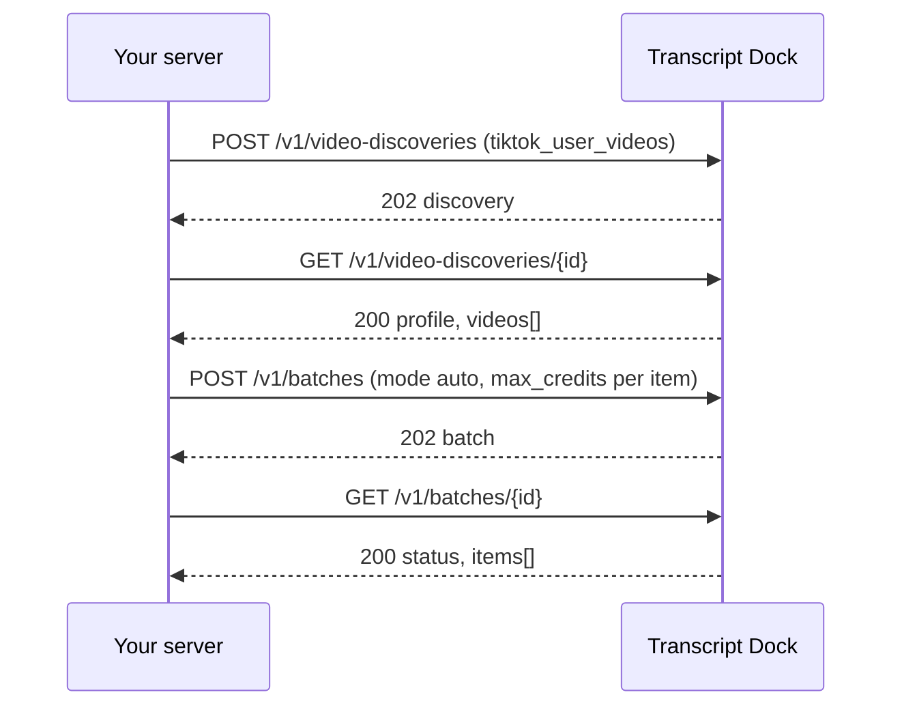

<p align="center">
  <a href="https://www.transcriptdock.com/platforms/tiktok"></a>
</p>

<h1 align="center">TikTok Transcript API</h1>

<p align="center">
  <strong>TikTok transcripts through one API: creator captions with their original timing, AI transcription when there are none, and profile video discovery.</strong>
</p>

<p align="center">
  <a href="https://www.transcriptdock.com/platforms/tiktok">Website</a> •
  <a href="https://www.transcriptdock.com/docs/api-reference">API docs</a> •
  <a href="https://www.transcriptdock.com/pricing">Pricing</a> •
  <a href="#quick-start">Quick start</a> •
  <a href="#examples">Examples</a> •
  <a href="./skills/tiktok-transcript-api/SKILL.md">Agent skill</a>
</p>

<p align="center">
  <a href="https://www.transcriptdock.com/docs/api-reference"></a>
  <a href="https://www.transcriptdock.com/docs/openapi.yaml"></a>
  <a href="https://www.transcriptdock.com/pricing"></a>
  <a href="https://www.transcriptdock.com/platforms/tiktok"></a>
  <a href="https://www.transcriptdock.com/docs/mcp"></a>
  <a href="https://pypi.org/project/transcriptdock/"></a>
  <a href="./LICENSE"></a>
</p>

---

This repo is the TikTok guide to the [Transcript Dock API](https://github.com/TranscriptDock/transcriptdock-api). The same API also covers YouTube, Instagram and your own files.

## Why use it for TikTok

- **Creator captions, parsed with their timing.** Subtitle tracks come back as timed segments, ready for SRT or VTT.
- **AI fallback.** Many TikToks have no subtitles. `auto` uses captions when they exist and AI transcription when they do not, with word timing and a spend cap.
- **Video and share links.** `tiktok.com/@user/video/...` links and `vm.tiktok.com/...` mobile share links both work.
- **Profile discovery.** List a profile's latest videos with the profile stats, then submit them as a batch.
- **Batches.** Up to 10, 25 or 50 links in one atomic request on Starter, Pro and Scale.
- **Exports included.** TXT, JSON, SRT and VTT, as often as you like, for free.
- **Safe to automate.** Idempotency keys on every create and `max_credits` on every AI job.

What it does not do: TikTok search is not available, and a profile listing returns at most 10 videos with no further pages. Only public videos work.

## How it works



1. **Submit** a video with `POST /v1/jobs`, or many with `POST /v1/batches`.
2. **Wait** with `GET /v1/jobs/{id}?wait=25`, which returns as soon as the job is final, or receive a [webhook](#webhooks).
3. **Read or export** with `GET /v1/transcripts/{result_id}` or `/export?format=txt|json|srt|vtt`.

### Modes for TikTok

| Mode | What it does | Cost |
|---|---|---|
| `captions_only` | The creator's subtitle track. Never starts AI transcription. Fails with `NO_CAPTIONS` when the video has none. | 1 credit per successful transcript |
| `auto` | Captions when they exist, AI transcription when they do not. Paid plans. | 1 credit with captions, otherwise 2 credits per started minute |
| `transcribe` | AI transcription of the audio, with word timing. Paid plans. | 2 credits per started minute, 60 second minimum |

`caption_languages` (up to 5 codes in order) picks among the subtitle tracks a video has.

## Endpoints

| Method | Path | What it does | Credits |
|---|---|---|---|
| `POST` | `/v1/jobs` | Transcribe one TikTok video | 1 per caption transcript, 2 per minute of AI transcription |
| `GET` | `/v1/jobs/{id}?wait=25` | Job status, long poll | Free |
| `POST` | `/v1/batches` | Many videos in one atomic request | Per item |
| `GET` | `/v1/batches/{id}` | Batch status and child jobs | Free |
| `GET` | `/v1/transcripts/{id}` | Transcript JSON | Free |
| `GET` | `/v1/transcripts/{id}/export` | `txt`, `json`, `srt` or `vtt` | Free |
| `POST` | `/v1/video-discoveries` | `tiktok_user_videos`: a profile's latest videos | 1 per page |
| `GET` | `/v1/video-discoveries/{id}` | Profile and videos | Free |
| `GET` | `/v1/capabilities` | What your key can do | Free |
| `GET` | `/v1/usage` | Plan and credit balance | Free |

### Profile discovery

```json
{ "kind": "tiktok_user_videos", "user": "@tiktok", "limit": 10, "include_details": false }
```

- `user` is an `@handle` or a profile URL.
- A listing reads the public profile embed. It carries at most 10 videos and has no next page.
- The result has a `profile` object (follower, following, heart and video counts when TikTok shows them) and a `tiktok` object on each video.
- `include_details: true` also fetches each video page for likes, comments, shares, hashtags, music and caption languages. A video page that fails keeps its row, with `tiktok.details_error` set.
- When TikTok challenges the request or embeds no list, the discovery fails with an error instead of returning partial data.
- 1 credit per discovery. Results are kept for 24 hours.

Full schemas: [API reference](https://www.transcriptdock.com/docs/api-reference), [OpenAPI 3.1](https://www.transcriptdock.com/docs/openapi.yaml) and the compact [docs/README.md](./docs/README.md).

## Credit costs

| What | Credits |
|---|---|
| Caption transcript (YouTube, TikTok) | 1 per successful transcript |
| AI transcription (any source) | 2 per started minute, 60 second minimum |
| Video discovery (YouTube search, channel, playlist, TikTok profile) | 1 per page |
| Caption language discovery (YouTube) | 1 |
| Failed job | 0 |
| Polling, transcript reads and exports | 0 |
| Idempotent replay (same key, same body) | 0 |
| Same video and options already transcribed in your workspace | 0 (`billing.kind: "cached"`) |

While a job runs, its maximum cost is held (`billing.credits_reserved`). When it finishes, only the real cost is charged (`billing.credits_charged`) and the rest is released.

### Worked examples

| Job | Credits |
|---|---|
| A TikTok with creator captions, `captions_only` | 1 |
| A TikTok with no captions, `captions_only` | 0 (fails with `NO_CAPTIONS`) |
| A 20 second TikTok with no captions, `auto` | 2 (the 60 second minimum) |
| A 90 second TikTok, `transcribe` | 4 (2 started minutes) |
| A 3 minute TikTok, `transcribe` | 6 |
| A profile listing of 10 videos, then a `captions_only` batch where 6 have captions | 1 + 6 = 7 |
| The same batch in `auto` mode, where the other 4 are 30 seconds each | 1 + 6 + (4 × 2) = 15 |

## Plans

One credit balance covers captions, AI transcription and discovery.

| | Free | Starter | Pro | Scale |
|---|---|---|---|---|
| Price | $0, no card | $19 a month or $190 a year | $49 a month or $490 a year | $149 a month or $1,490 a year |
| Credits | 50 every 30 days | 2,000 a month | 6,000 a month | 20,000 a month |
| Extra credits | Not available | $8 per 1,000 | $7 per 1,000 | $6 per 1,000 |
| Sources | YouTube and TikTok captions | YouTube, TikTok, Instagram, uploads, direct links | YouTube, TikTok, Instagram, uploads, direct links | YouTube, TikTok, Instagram, uploads, direct links |
| AI transcription | Not included | 2 credits a minute | 2 credits a minute | 2 credits a minute |
| Batch size | 1 link | 10 links | 25 links | 50 links |
| Submits a minute | 10 | 60 | 120 | 300 |
| Jobs in progress | 10 | 100 | 500 | 2,000 |
| Retention | 7 days | 30 days | 90 days | 90 days |

Yearly billing gives 2 months free. Yearly plans still get their credits every month, and unused monthly credits do not roll over. Purchased credits never expire. Reads (job polling, transcripts, exports) have a separate limit of 120 a minute on every plan. Prices and limits can change: [transcriptdock.com/pricing](https://www.transcriptdock.com/pricing) is the source of truth.

## Quick start

1. [Create a free account](https://www.transcriptdock.com/signup). The free plan includes 50 caption credits every 30 days.
2. Create an API key in the [dashboard](https://www.transcriptdock.com/dashboard) and keep it on your server:

```bash
export TRANSCRIPTDOCK_API_KEY="td_live_..."
```

### cURL

```bash
# Creator captions only. At most 1 credit, nothing if there are none.
curl -sS -X POST https://www.transcriptdock.com/v1/jobs \
  -H "Authorization: Bearer $TRANSCRIPTDOCK_API_KEY" \
  -H "Idempotency-Key: $(uuidgen)" \
  -H "Content-Type: application/json" \
  -d '{"source":{"url":"https://www.tiktok.com/@tiktok/video/7680721699171601694"},"mode":"captions_only","max_credits":1}'

# Wait for the job, up to 25 seconds per call
curl -sS "https://www.transcriptdock.com/v1/jobs/JOB_ID?wait=25" \
  -H "Authorization: Bearer $TRANSCRIPTDOCK_API_KEY"

# Export as SRT
curl -sS "https://www.transcriptdock.com/v1/transcripts/RESULT_ID/export?format=srt" \
  -H "Authorization: Bearer $TRANSCRIPTDOCK_API_KEY"
```

### JavaScript (Node 18+, no dependencies)

```js
import { randomUUID } from "node:crypto";

const API = "https://www.transcriptdock.com";
const auth = { Authorization: `Bearer ${process.env.TRANSCRIPTDOCK_API_KEY}` };

async function call(method, path, body, idempotencyKey) {
  const res = await fetch(API + path, {
    method,
    redirect: "error",
    headers: {
      ...auth,
      ...(body && { "Content-Type": "application/json" }),
      ...(idempotencyKey && { "Idempotency-Key": idempotencyKey }),
    },
    body: body && JSON.stringify(body),
  });
  if (!res.ok) throw new Error(`${res.status} ${await res.text()}`);
  return path.includes("/export") ? res.text() : res.json();
}

// auto: captions when they exist, otherwise AI transcription. Paid plans.
// max_credits 6 accepts videos up to 3 minutes (2 credits per started minute).
let job = await call("POST", "/v1/jobs", {
  source: { url: "https://www.tiktok.com/@tiktok/video/7680721699171601694" },
  mode: "auto",
  max_credits: 6,
}, randomUUID());

while (!["succeeded", "failed", "cancelled"].includes(job.status)) {
  job = await call("GET", `/v1/jobs/${job.id}?wait=25`);
}

if (job.status !== "succeeded") throw new Error(`${job.status}: ${job.error?.code}`);
console.log(job.billing); // kind is captions or ai_transcription
console.log(await call("GET", `/v1/transcripts/${job.result_id}/export?format=txt`));
```

### Python (`pip install transcriptdock`)

```python
import os
from uuid import uuid4
from transcriptdock import TranscriptDock, JobTimeoutError

client = TranscriptDock(os.environ["TRANSCRIPTDOCK_API_KEY"])

# Generate once per intended operation. Save this key and the returned job ID.
submission_key = str(uuid4())
job = client.create_job(
    {"source": {"url": "https://www.tiktok.com/@tiktok/video/7680721699171601694"},
     "mode": "captions_only", "max_credits": 1},
    idempotency_key=submission_key,
)
try:
    job = client.wait_for_job(job["id"], timeout=120)
except JobTimeoutError as error:
    print("Still running", error.job)
else:
    if job["status"] == "succeeded":
        print(client.export_transcript(job["result_id"], "srt"))
    else:
        print(job["status"], job.get("error"))
```

## What you get back

Example data. A TikTok caption transcript from `GET /v1/transcripts/{result_id}`:

```json
{
  "id": "22222222-2222-4222-8222-222222222222",
  "source": {
    "platform": "tiktok",
    "media_id": "7000000000000000000",
    "canonical_url": "https://www.tiktok.com/@example/video/7000000000000000000",
    "title": null
  },
  "source_origin": "creator_captions",
  "language": "en",
  "text": "Three things I wish I knew before my first marathon.",
  "segments": [
    { "start": 0.0, "end": 1.8, "text": "Three things I wish I knew" },
    { "start": 1.8, "end": 3.4, "text": "before my first marathon." }
  ],
  "words": null,
  "timing_granularity": "segment",
  "duration_seconds": null,
  "recognition": null,
  "extraction_version": "worker-0.1.0",
  "created_at": "2026-11-18T10:00:14.000Z"
}
```

When AI transcription produced the text, `source_origin` is `speech_recognition`, `timing_granularity` is `word`, `words` holds `{ start, end, text, confidence }` per word and `recognition` names the profile, model and language quality status. Times are in seconds.

A finished profile discovery (example data, trimmed to one video):

```json
{
  "id": "55555555-5555-4555-8555-555555555555",
  "kind": "tiktok_user_videos",
  "status": "succeeded",
  "request": { "kind": "tiktok_user_videos", "user": "@example", "limit": 10 },
  "profile": { "unique_id": "example", "nickname": "Example", "verified": false, "follower_count": 1200, "video_count": 87 },
  "videos": [
    {
      "platform": "tiktok",
      "video_id": "7000000000000000000",
      "url": "https://www.tiktok.com/@example/video/7000000000000000000",
      "title": "Three things I wish I knew before my first marathon",
      "channel_id": null,
      "channel_title": null,
      "duration_s": 34,
      "published_at": null,
      "published_text": null,
      "view_count": 5400,
      "view_count_text": null,
      "thumbnail_url": null,
      "tiktok": { "description": "Three things I wish I knew before my first marathon", "duration_s": 34, "play_count": 5400 }
    }
  ],
  "next_cursor": null,
  "error": null,
  "created_at": "2026-11-18T12:00:00.000Z",
  "updated_at": "2026-11-18T12:00:03.000Z",
  "expires_at": "2026-11-19T12:00:00.000Z"
}
```

## Webhooks

Polling with `?wait=25` is fine for scripts. For pipelines, register a webhook and let Transcript Dock call you.

1. Register an `https` URL on the Webhooks page of the [dashboard](https://www.transcriptdock.com/dashboard). Registering and disabling endpoints needs a signed in session. An API key can list endpoints but gets `403 FORBIDDEN` when it tries to create one. The signing secret is shown once: store it like a password.
2. Pass the endpoint id as `webhook_endpoint_id` when you create a job or a batch.
3. Transcript Dock sends `job.succeeded`, `job.failed` or `batch.completed` when the work is final.

```json
{
  "event_id": "44444444-4444-4444-8444-444444444444",
  "type": "job.succeeded",
  "created_at": "2026-11-18T10:00:14.000Z",
  "job_id": "11111111-1111-4111-8111-111111111111",
  "batch_id": null,
  "result_id": "22222222-2222-4222-8222-222222222222",
  "metadata": { "order": "8812" },
  "error": null
}
```

The event does not carry the transcript text. Fetch or export `result_id` when you receive it.

**Verify every delivery.** Each request has three headers: `X-TranscriptDock-Event-Id`, `X-TranscriptDock-Timestamp` and `X-TranscriptDock-Signature`. The signature is a hex HMAC SHA256 of `{event_id}.{timestamp}.{raw_body}` keyed with your endpoint secret.

- Compute it over the raw request body, before any JSON parsing.
- Compare in constant time.
- Reject timestamps more than five minutes away from your clock.
- Answer with any 2xx within a few seconds, and do the slow work afterwards. Redirects are not followed.
- Failed deliveries are retried with backoff, and an event can arrive more than once. Deduplicate on `event_id`.

```js
import { createHmac, timingSafeEqual } from "node:crypto";

export function verifyTranscriptDock(eventId, timestamp, rawBody, signature, secret) {
  if (Math.abs(Date.now() / 1000 - Number(timestamp)) > 300) return false;
  const expected = createHmac("sha256", secret)
    .update(`${eventId}.${timestamp}.`)
    .update(rawBody) // the exact bytes you received
    .digest("hex");
  return expected.length === String(signature).length &&
    timingSafeEqual(Buffer.from(expected), Buffer.from(String(signature)));
}
```

The full contract, including retries and payload fields, is in the [webhook docs](https://www.transcriptdock.com/docs/api-reference#webhooks).

## Errors

Every error has the same envelope. Quote `request_id` (also sent as the `X-Request-Id` header) when you contact support.

```json
{
  "error": {
    "code": "INSUFFICIENT_BALANCE",
    "message": "Not enough credits. Buy credits or upgrade your plan to continue.",
    "retryable": false,
    "details": { "detail": "This job needs more credits than you have left." },
    "doc_url": "https://www.transcriptdock.com/docs/api-reference#error-codes"
  },
  "request_id": "66666666-6666-4666-8666-666666666666"
}
```

A job that fails after it was accepted still returns HTTP 200 on `GET /v1/jobs/{id}`, with `status: "failed"` and the same error object in `error`. Failed jobs cost nothing.

| Code | HTTP | Retry | What to do |
|---|---|---|---|
| `INVALID_REQUEST` | 422 | No | A field is missing or malformed. `details.detail` names it. |
| `INVALID_URL` / `UNSUPPORTED_SOURCE` | 422 | No | Send a supported https link. |
| `CAPABILITY_UNAVAILABLE` | 422 | No | That mode is not available for this source. Check `GET /v1/capabilities`. |
| `UNAUTHENTICATED` | 401 | No | Missing or invalid API key. |
| `FORBIDDEN` | 403 | No | The key lacks the scope for this endpoint. |
| `INSUFFICIENT_BALANCE` | 402 | No | Buy credits or upgrade. |
| `PLAN_REQUIRED` | 402 | No | AI transcription, Instagram, uploads and larger batches need a paid plan. |
| `BUDGET_EXCEEDED` | 402 | No | The measured cost is above `max_credits`. Nothing was charged. Raise the cap or skip the media. |
| `IDEMPOTENCY_CONFLICT` | 409 | No | The key was used with a different body. Use a new key. |
| `JOB_NOT_RETRYABLE` | 409 | No | The failure was final. Fix the input and submit a new job. |
| `RATE_LIMITED` | 429 | Yes | Wait `Retry-After` seconds, then resend with the same idempotency key. |
| `NO_CAPTIONS` | 422 | No | The video has no captions and the mode was `captions_only`. Use `auto` or `transcribe`. |
| `LANGUAGE_UNAVAILABLE` | 422 | No | None of `caption_languages` exists on the video. Drop the list to take the default track. |
| `SOURCE_NOT_FOUND` / `SOURCE_PRIVATE` / `SOURCE_AUTH_REQUIRED` / `SOURCE_REGION_RESTRICTED` | 422 | No | Only public, reachable media works. |
| `DURATION_LIMIT_EXCEEDED` / `FILE_TOO_LARGE` | 413 | No | Media over 2 hours or 250 MB. |
| `TIMESTAMPS_UNAVAILABLE` | 422 | No | No timing for SRT or VTT. Export `txt` or `json`. |
| `SOURCE_RATE_LIMITED` / `SOURCE_BLOCKED` / `SOURCE_TIMEOUT` | 503 | Yes | The platform is throttling. The job retries automatically. |
| `INTERNAL_ERROR` | 500 | Yes | Retry with the same idempotency key. Report the request id if it persists. |

The [full error list](https://www.transcriptdock.com/docs/api-reference#error-codes) has every code.

## Idempotency and spend caps

Two habits make the API safe to call from scripts, queues and agents.

**Send an `Idempotency-Key` on every create.** It is required on `POST /v1/jobs`, `/v1/batches`, `/v1/video-discoveries`, `/v1/language-discoveries` and `/v1/jobs/{id}/retry`. Use 8 to 128 printable ASCII characters.

- Same key and same body: you get the original object back. Nothing is created or charged twice.
- Same key and a different body: `409 IDEMPOTENCY_CONFLICT`.
- Generate the key once per intended operation and save it with your record. If a response is lost, resend the same body with the same key. Never resubmit blindly with a fresh key.
- A good key is your own id for the thing you are transcribing, for example `yt-dQw4w9WgXcQ-captions`.
- A retry (`POST /v1/jobs/{id}/retry`) needs a new key, because it is a new job.

**Set `max_credits` on AI transcription.** The media is measured first. If the cost would be above your cap, the job fails with `BUDGET_EXCEEDED` and nothing is charged. Without a cap the default covers the 2 hour maximum (240 credits).

| Longest media you accept | `max_credits` |
|---|---|
| 1 minute | 2 |
| 5 minutes | 10 |
| 10 minutes | 20 |
| 30 minutes | 60 |
| 2 hours | 240 |

`max_credits` is ignored for `captions_only`, which always costs 1 credit. The examples in this repo still send it, so a later switch to `auto` keeps a cap.

## Examples

Every example reads `TRANSCRIPTDOCK_API_KEY`, sends an idempotency key and caps `max_credits`. They spend real credits, so read the comment at the top of each file first.

| Example | What it shows |
|---|---|
| [curl/examples.sh](./examples/curl/examples.sh) | Captions, `auto` with a cap, profile discovery, batches, wait and export |
| [javascript/captions.mjs](./examples/javascript/captions.mjs) | Creator captions, printed with timestamps and exported as SRT |
| [javascript/profile-to-batch.mjs](./examples/javascript/profile-to-batch.mjs) | Profile discovery, then a batch of caption jobs |
| [javascript/auto-fallback.mjs](./examples/javascript/auto-fallback.mjs) | `auto` mode with `max_credits`, showing what the job paid for |
| [python/captions.py](./examples/python/captions.py) | Captions with the `transcriptdock` package |
| [python/profile_batch.py](./examples/python/profile_batch.py) | Profile discovery, batch, then each transcript as text |
| [python/auto_fallback.py](./examples/python/auto_fallback.py) | AI fallback with a spend cap and a `NO_CAPTIONS` explanation |

```bash
node examples/javascript/profile-to-batch.mjs @tiktok 5
python examples/python/auto_fallback.py "https://www.tiktok.com/@tiktok/video/7680721699171601694" 6
bash examples/curl/examples.sh help
```

## SDKs

Plain HTTP works everywhere, and every example in this repo uses either `fetch` or the Python SDK. Typed clients:

| Language | Package | Status |
|---|---|---|
| Python | [`transcriptdock`](https://pypi.org/project/transcriptdock/) on PyPI ([source](https://github.com/TranscriptDock/transcriptdock-python)) | Published |
| Go | [`github.com/TranscriptDock/transcriptdock-go`](https://github.com/TranscriptDock/transcriptdock-go) | Published |
| Ruby | `transcriptdock` gem ([source](https://github.com/TranscriptDock/transcriptdock-ruby)) | Published |
| PHP | `transcriptdock/transcriptdock` on Packagist ([source](https://github.com/TranscriptDock/transcriptdock-php)) | Published |
| .NET | `TranscriptDock` on NuGet ([source](https://github.com/TranscriptDock/transcriptdock-dotnet)) | Published |
| JavaScript and TypeScript | `transcriptdock` on npm ([source](https://github.com/TranscriptDock/transcriptdock-js)) | Coming soon |
| Dart and Flutter | `transcriptdock` on pub.dev ([source](https://github.com/TranscriptDock/transcriptdock-dart)) | Coming soon |
| Java | `com.transcriptdock:transcriptdock` ([source](https://github.com/TranscriptDock/transcriptdock-java)) | Coming soon |
| Rust | `transcriptdock` on crates.io ([source](https://github.com/TranscriptDock/transcriptdock-rust)) | Coming soon |
| Swift | Swift Package Manager ([source](https://github.com/TranscriptDock/transcriptdock-swift)) | Coming soon |

Generating your own client? Start from the [OpenAPI 3.1 spec](https://www.transcriptdock.com/docs/openapi.yaml) ([repo](https://github.com/TranscriptDock/transcriptdock-openapi)). No code at all: the [n8n node](https://github.com/TranscriptDock/n8n-nodes-transcriptdock) (`n8n-nodes-transcriptdock`) and the [Apify Actor](https://github.com/TranscriptDock/transcriptdock-apify).

## MCP and AI agents

### Hosted MCP server

Transcript Dock runs a hosted MCP server at `https://www.transcriptdock.com/mcp` (Streamable HTTP). It signs you in with OAuth, or accepts an API key as a bearer header. Use the `www` URL exactly: the apex domain redirects, and clients drop the `Authorization` header on a cross origin redirect.

```bash
claude mcp add --transport http transcriptdock https://www.transcriptdock.com/mcp
```

Then run `/mcp` in Claude Code and choose Authenticate. In the Claude apps, add `https://www.transcriptdock.com/mcp` as a custom connector. Cursor, Windsurf and other clients are covered in the [MCP docs](https://www.transcriptdock.com/docs/mcp). A local stdio server is on npm as `@transcriptdock/mcp` ([source](https://github.com/TranscriptDock/transcriptdock-mcp)).

The MCP tools include `get_video_transcript` (submit, wait and return text in one call), `transcribe`, `get_job`, `get_transcript`, `wait_for_job`, `search_youtube`, `list_channel_videos`, `list_playlist_videos` and `list_tiktok_user_videos`.

### Agent skill in this repo

[`skills/tiktok-transcript-api/SKILL.md`](./skills/tiktok-transcript-api/SKILL.md) teaches an agent to use the HTTP API safely: check capabilities, submit with an idempotency key and a `max_credits` cap, wait, export, ask before paid AI transcription, and never invent timestamps.

```bash
# Claude Code: install for every project
mkdir -p ~/.claude/skills
cp -r skills/tiktok-transcript-api ~/.claude/skills/

# or for one project
mkdir -p .claude/skills
cp -r skills/tiktok-transcript-api .claude/skills/
```

The skill reads your key from `TRANSCRIPTDOCK_API_KEY`. Never paste a key into a chat.

## FAQ

<details>
<summary><strong>Which captions does it read?</strong></summary>

The creator's subtitle track, with its original timing per cue. When a video has none, `captions_only` fails with `NO_CAPTIONS` at no cost and `auto` falls back to AI transcription.
</details>

<details>
<summary><strong>Do vm.tiktok.com share links work?</strong></summary>

Yes. Mobile share links and standard `tiktok.com/@user/video/...` links are both accepted.
</details>

<details>
<summary><strong>Can I search TikTok or page through a whole profile?</strong></summary>

No. TikTok search is not available, and a profile listing returns at most 10 of the latest videos with no next page. For a known list of videos, submit the links directly as a batch.
</details>

<details>
<summary><strong>Why did a profile discovery fail?</strong></summary>

The listing reads TikTok's public embed. When TikTok challenges the request, or the profile is private or embeds no list, the discovery fails with an error instead of returning partial data. Try again later or submit video links directly.
</details>

<details>
<summary><strong>Is AI transcription on the free plan?</strong></summary>

No. The free plan covers caption transcripts for YouTube and TikTok. `auto` and `transcribe` need a paid plan and answer `402 PLAN_REQUIRED` on the free plan.
</details>

<details>
<summary><strong>How accurate are the timestamps?</strong></summary>

Caption transcripts keep the creator's cue timing, so `timing_granularity` is `segment`. AI transcription adds per word timing with a confidence score. Times are in seconds.
</details>

## More Transcript Dock repos

| Repo | Focus |
|---|---|
| [transcriptdock-api](https://github.com/TranscriptDock/transcriptdock-api) | The hub: every source, every endpoint, uploads and webhooks |
| [youtube-transcript-api](https://github.com/TranscriptDock/youtube-transcript-api) | YouTube captions, automatic captions, AI transcription, search, channel and playlist discovery |
| [instagram-transcript-api](https://github.com/TranscriptDock/instagram-transcript-api) | AI transcription for public Instagram Reels and video posts |

## Chrome extension

Want transcripts without writing code? The [Transcript Dock extension for Chrome](https://chromewebstore.google.com/detail/bepajpcnjahahnkjkfeojmpbddakoodg) shows transcripts beside YouTube, TikTok and Instagram videos. More at [transcriptdock.com/extension](https://www.transcriptdock.com/extension).

---

## Issues and feedback

This repo holds examples, docs and an agent skill for the hosted Transcript Dock API.

- Found a bug in an example, or the API behaving differently from the docs? [Open an issue](../../issues/new/choose) and include the `X-Request-Id`.
- Have an idea for a feature or a new example? Open a feature request.
- Security issue? Email [transcriptdock@volods.com](mailto:transcriptdock@volods.com) instead of opening an issue.

See [CONTRIBUTING.md](./CONTRIBUTING.md) before sending a pull request.

## Links

- Website: [transcriptdock.com](https://www.transcriptdock.com)
- Docs: [quickstart](https://www.transcriptdock.com/docs/quickstart), [API reference](https://www.transcriptdock.com/docs/api-reference), [sources](https://www.transcriptdock.com/docs/platforms)
- OpenAPI spec: [openapi.yaml](https://www.transcriptdock.com/docs/openapi.yaml)
- Pricing: [transcriptdock.com/pricing](https://www.transcriptdock.com/pricing)
- Changelog: [docs/changelog](https://www.transcriptdock.com/docs/changelog)
- Contact: [transcriptdock@volods.com](mailto:transcriptdock@volods.com)

## License

The examples, docs and skill in this repository are released under the [MIT License](./LICENSE).

The Transcript Dock API is a hosted service covered by its [Terms of Service](https://www.transcriptdock.com/docs/terms).
